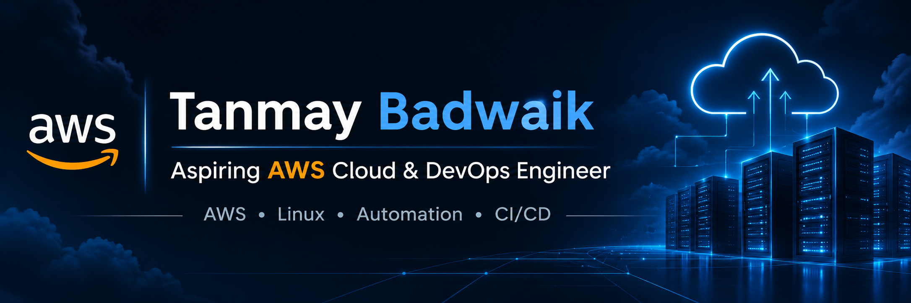

 

# Hi, I'm Tanmay Badwaik 👋

### Aspiring AWS Cloud & DevOps Engineer

*Building, learning, and improving through practical cloud projects.*

[LinkedIn](https://www.linkedin.com/in/tanmay-badwaik-devops-engineer/) · [GitHub](https://github.com/tanmay-badwaik)

---

## 👨‍💻 About Me

- Focused on **AWS Cloud, Linux, and DevOps**.
- Interested in cloud infrastructure, application deployment, and automation.
- Learning by building projects and practising real-world scenarios.
- Currently strengthening my skills in CI/CD, containers, and infrastructure as code.

## 🧰 Technologies & Tools

**Cloud:** AWS (EC2, VPC, S3, IAM, RDS, ELB, Auto Scaling, CloudWatch)  
**Operating Systems:** Linux (Ubuntu, Amazon Linux)  
**Version Control:** Git, GitHub, GitLab  
**Infrastructure as Code:** Terraform  
**Containers & Orchestration:** Docker, Kubernetes  
**Web Servers:** Apache, Nginx, Tomcat  
**Databases:** MySQL, MariaDB  
**Scripting:** Bash and Python fundamentals  

## 🚀 Featured Projects

### AWS Three-Tier Web Application
- Built a three-tier application architecture on AWS.
- Worked with VPC, public and private subnets, EC2, Application Load Balancer, Auto Scaling, and Amazon RDS.
- Configured application-to-database connectivity using MariaDB.

### Student Management System
- Worked on a web-based student management application.
- Configured the application environment and MariaDB database connectivity.

### Help Desk IT Ticket Management System
- Worked on an IT ticket management application for creating and tracking support requests.

> Add links to each project repository above once the corresponding repositories are public.

## 📊 GitHub Statistics

 

## 📈 Contribution Activity

  

## 🌱 Currently Learning

- Jenkins and CI/CD pipelines
- Docker and Kubernetes
- AWS cloud architecture and services
- Linux administration and troubleshooting
- Terraform and infrastructure automation

## 🤝 Connect With Me

---

**Build • Learn • Automate • Grow**

